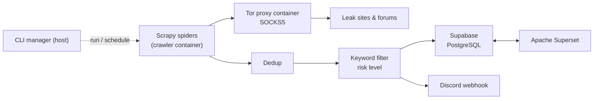

# TriCrawl

**Know the moment stolen data about you lands on the dark web.**

TriCrawl monitors ransomware leak sites and underground forums over Tor. It collects new posts on a schedule, drops what it has already seen, scores what's left against your watchlist, alerts Discord in real time and archives everything for trend analysis.

<p align="center">
  <a href="media/tricrawl.mp4"></a>
  <br>
  <sub><a href="media/tricrawl.mp4">Watch the full video (0:47)</a></sub>
</p>


## Why

Ransomware groups publish victims on their leak blogs, and stolen databases are traded on forums. Most organizations find out last, from a journalist or a customer. Watching these sources by hand is slow, risky and easy to forget. TriCrawl automates the watch and turns raw posts into a short list of alerts that matter to you.

## Features

- **Anonymous by default.** Every request goes through a Tor SOCKS5 proxy running in its own container.
- **Nine sources, one crawler.** Six ransomware leak blogs and three underground forums, each with its own spider.
- **Dedup before detail.** Post IDs are checked before any detail page is fetched, so known posts never cost another Tor round trip.
- **Watchlist scoring.** Posts are matched against target keywords (countries, sectors, company names) and conditional patterns, then graded CRITICAL, HIGH, MEDIUM or LOW.
- **Real-time alerts.** Matching posts go to Discord as risk-coded embeds with source, target and keywords. Alerts can be toggled from the CLI.
- **Archive and analytics.** Every structured post is stored in PostgreSQL (Supabase) and visualized in Apache Superset: totals, critical counts, posts per day and top sources.
- **One CLI.** An interactive manager starts and stops the stack, runs crawls, schedules monitoring every N hours with a live countdown, exports data to JSONL or CSV, and opens logs and the dashboard.

### Sources

| Spider | Type | Site |
|:---|:---|:---|
| `abyss` | Ransomware | Abyss leak blog |
| `akira` | Ransomware | Akira leak blog |
| `lockbit` | Ransomware | LockBit 3.0 leak blog (archive) |
| `lockbit5` | Ransomware | LockBit 5.0 leak blog |
| `play_news` | Ransomware | Play leak blog |
| `rhysida` | Ransomware | Rhysida leak blog |
| `best_carding_world` | Forum | Best Carding World |
| `bfdx` | Forum | BFDX hacking forum |
| `darknet_army` | Forum | DarkNetArmy (XenForo) |

## How it works



Items flow through Scrapy pipelines in order: deduplication, keyword filtering and risk scoring, storage, then notification. The crawler, Tor proxy and Superset run as isolated Docker containers; the CLI on the host orchestrates them.

## Getting started

**Requirements:** Docker Desktop (running), Python 3.10+, and a Supabase project.

### 1. Create the table

Run this in the Supabase SQL editor:

```sql
create table public.darkweb_leaks (
  dedup_id text primary key,
  source text not null,
  title text,
  url text,
  content text,
  risk_level text,
  matched_keywords text[],
  posted_at timestamp with time zone,
  crawled_at timestamp with time zone default now(),
  author text,
  views int default 0,
  category text,
  site_type text,
  author_contacts jsonb
);

-- Optional: public read access
alter table public.darkweb_leaks enable row level security;
create policy "Enable read access for all users" on public.darkweb_leaks for select using (true);
```

### 2. Configure

```bash
git clone https://github.com/toumai266/tricrawl.git
cd tricrawl
cp .env.example .env
```

| Variable | Description |
|:---|:---|
| `DISCORD_WEBHOOK_URL` | Discord channel webhook for alerts |
| `SUPABASE_URL` | Supabase project URL |
| `SUPABASE_KEY` | Supabase `anon` key |
| `SUPERSET_CLOUD_URL` | (Optional) URL of a hosted Superset dashboard |

Watchlist keywords live in `config/keywords.yaml`.

### 3. Install and run

```bash
python -m venv venv
source venv/bin/activate        # Windows: .\venv\Scripts\activate
pip install -r requirements.txt

python main.py
```

| Menu | Action |
|---|---|
| 1. Start Crawl | Run one spider or all of them |
| 2. Monitoring Mode | Scheduled crawls with a live countdown |
| 3. Open Dashboard | Open Superset |
| 4. View Logs | Open the latest log file |
| 5. Start Docker | Start the Tor proxy and services (run this first) |
| 6. Stop Docker | Stop all services |
| 7. Export DB | Dump collected data to JSONL or CSV |
| 8. Toggle Discord | Turn alerts on or off |

More detail: [usage guide](./docs/usage_guide.md), [analytics guide](./docs/analytics_guide.md), [Superset guide](./docs/superset_guide.md).

## Responsible use

TriCrawl is intended for defensive security and threat intelligence only.

---

More projects at [hhkb.dev](https://hhkb.dev) · [Intbox](https://intbox.org)
